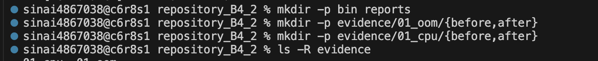
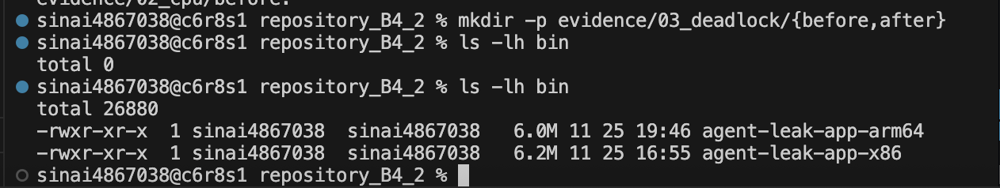
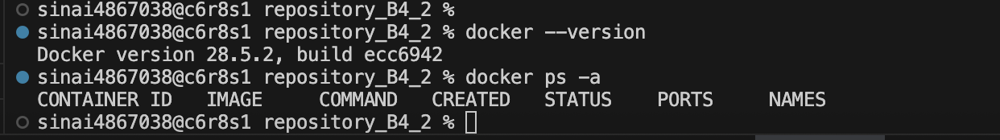

## 1. 과제 설명
- memoru leak, CPU Spike, Deadlock 의 시스템 장애 현상을 확인하고, 환경변수 조정을 통해 어떻게 장애 현상에 영향을 줄 수 있는지 확인한다.
- 각 장애 유형은 git에 issue에 아래 내용이 반드시 들어가도록 리포트 형태로 작성한다.
- 발생 현상: 장애가 어떻게 관측되었는지 서술
- 재현 경로 및 증거: 로그/명령어 출력/스크린샷 등 객관적 증거 첨부
- 근본 원인: 장애의 기술적 원인 분석
- 조치 내용: 환경변수 조정 등 임시 조치와 그 결과
- 결과 확인: 조치 후 Before & After 비교 결과

## 2. 개발 환경
- 바이너리 (agent-app-leek.zip 파일. x86과 arm64 버전 존재) 를 실행할 수 있는 리눅스 버전 => docker container 에서 실행 예정
- 아래 내용이 충족되어야 한다.

## 3. 실습 과정
1) 디렉토리 생성
- 생성 중 디렉토리 내부에 하위 디렉토리를 생성해버려서 삭제 후 재생성하는 과정 거침

2) docker 및 pc의 CPU 확인

