## 1. 과제 설명
- memoru leak, CPU Spike, Deadlock 의 시스템 장애 현상을 확인하고, 환경변수 조정을 통해 어떻게 장애 현상에 영향을 줄 수 있는지 확인한다.
- 각 장애 유형은 git에 issue에 아래 내용이 반드시 들어가도록 리포트 형태로 작성한다.
- 발생 현상: 장애가 어떻게 관측되었는지 서술
- 재현 경로 및 증거: 로그/명령어 출력/스크린샷 등 객관적 증거 첨부
- 근본 원인: 장애의 기술적 원인 분석
- 조치 내용: 환경변수 조정 등 임시 조치와 그 결과
- 결과 확인: 조치 후 Before & After 비교 결과

## 2. 개발 환경
- 바이너리 (agent-app-leek.zip 파일. x86과 arm64 버전 존재) 를 실행할 수 있는 리눅스 버전 => docker container 에서 실행 예정
- 아래 내용이 충족되어야 한다.
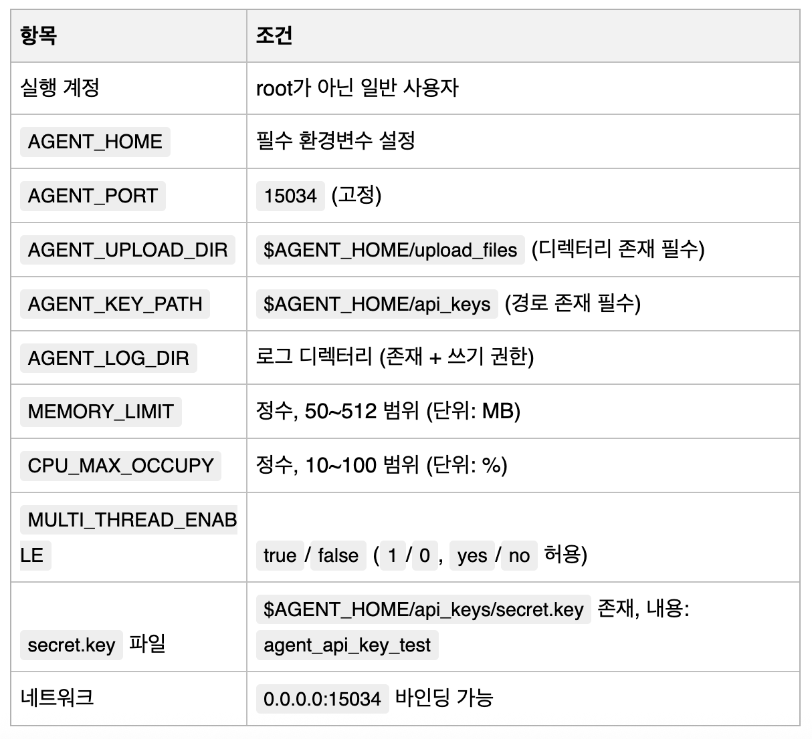

## 3. 실습 과정
### 1. 환경 구축
1) VScode - git 연동
2) 디렉토리 생성
- 생성 중 디렉토리 내부에 하위 디렉토리를 생성해버려서 삭제 후 재생성하는 과정 거침


- 생성된 디렉토리 구조
repository_B4_2
— bin (실행 프로그램 보관 폴더)
——— agent-leak-app-arm64
——— agent-leak-app-x86
— evidence (장애 발생 증거 보관 폴더)
——— 01_oom (메모리 누수 장애)
————— before (조치 전)
————— after (조치 후)   
——— 02_cpu (cpu 과부화 장애)
————— before (조치 전)
————— after (조치 후)
——— 03_deadlock (교착상태 장애)
————— before (조치 전)
————— after (조치 후)
— reports (기술보고서 보관 폴더)
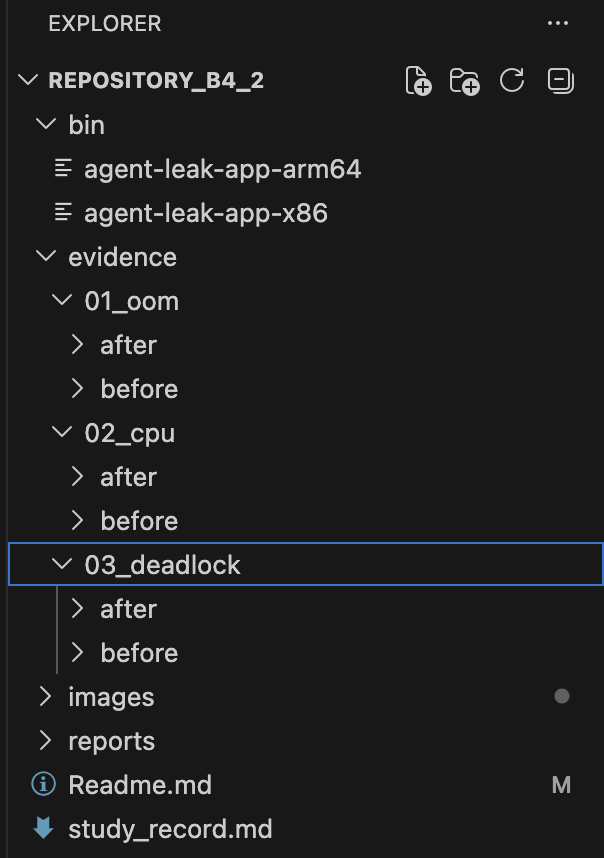

3) docker 및 pc의 CPU 확인
- docker 설치 상태 확인 & 컨테이너 존재 여부 확인


- cpu 아키텍쳐 확인
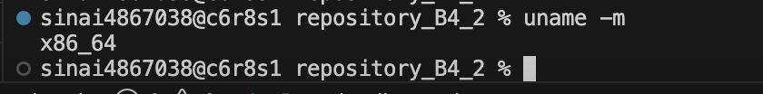

4) docker에 우분투 컨테이너 생성
- 장애를 재현해볼 수 있는 리눅스 실험환경 컨테이너 생성
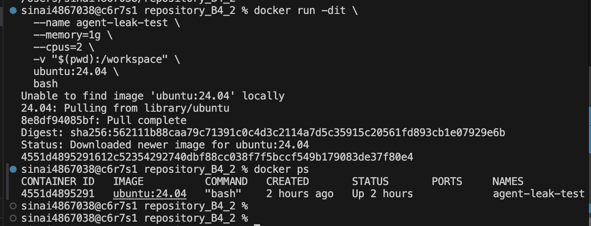
- 명령어 설명 : 
- docker run	컨테이너 생성 및 실행
- -dit	백그라운드 실행 및 터미널 사용 설정
- --name agent-leak-test	컨테이너 이름 지정
- --memory=1g	메모리 사용량 1GiB 제한
- --cpus=2	CPU 2개에 해당하는 연산 시간 제한
- -v "$(pwd):/workspace"	바인드 마운트 설정
  (바인드마운트로 인해 host pc의 바이너리 파일을 우분투 내에서 사용 가능하며, 아직 포트는 지정하지 않음)
- ubuntu:24.04	Ubuntu 24.04 이미지 사용
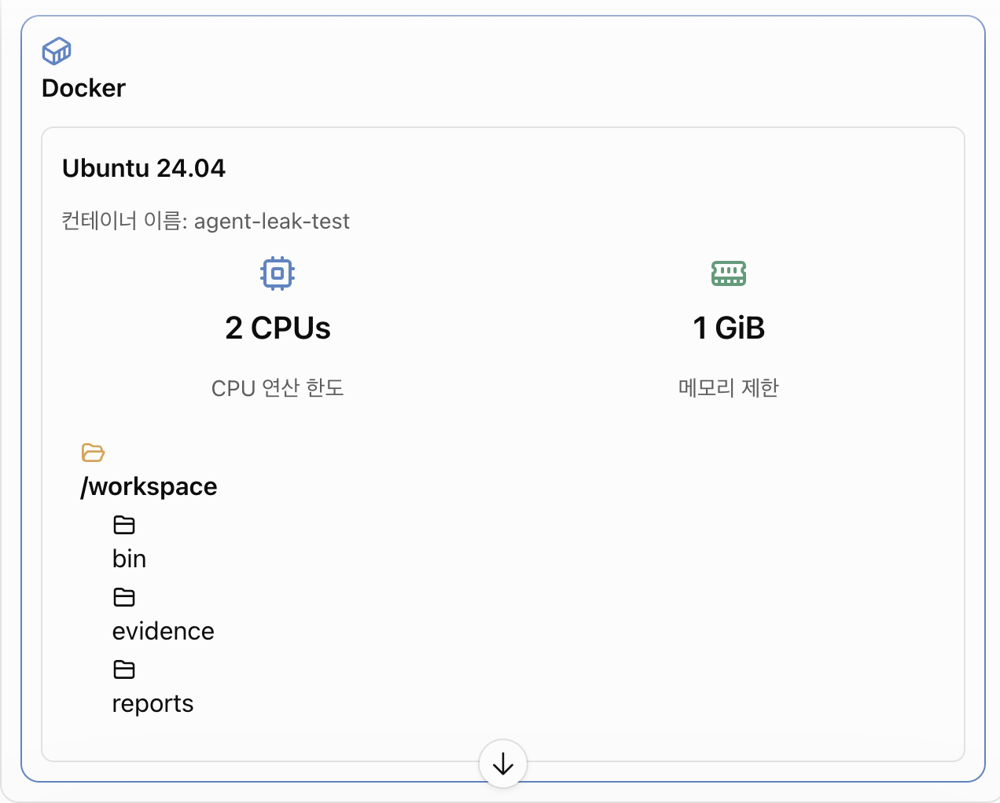

| 구분 | Docker	| agent-leak-app |
| 메모리 제한 |	--memory=1g	| MEMORY_LIMIT |
| CPU 제한 | --cpus=2 | CPU_MAX_OCCUPY |
| 관리 대상	| 컨테이너 전체	| 개별 애플리케이션 |
| 관리 방식	| Linux 커널의 자원 제어 | 프로그램 자체의 보호 정책 |

5) 우분투 진입 (명령어 설명))
- 명령어 설명 : 
- docker exec : 실행 중인 컨테이너에서 명령어 실행
- -it : 터미널을 통해 직접 명령어 입력 가능
- 4551d4895291 : 접속할 컨테이너의 ID
- bash : Bash 셸 실행
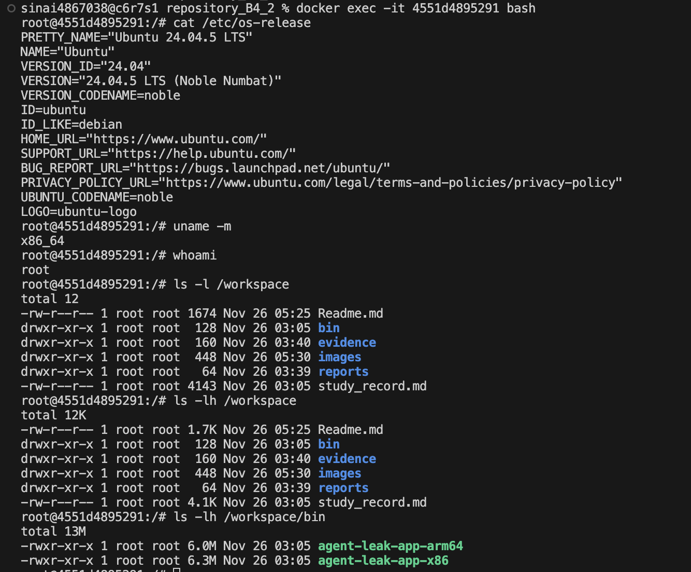

| 구분 | Docker 진입 전 | Docker 진입 후 |
| 운영체제 | Host OS | Ubuntu |
| 사용자 | Host PC 사용자 | root |
| 파일 경로 | Host PC 경로 | Linux 경로 |
| Docker 명령어 | 사용 가능	| 일반적으로 사용하지 않음 |
| Linux 프로그램 실행 | 환경에 따라 다름 | 가능 |

6) 패키지 설치 및 계정 전환 
- 장애 관측 및 원인 분석용 패키지
- 패키지 설치 명령어 : apt install -y procps iproute2 file curl nano psmisc
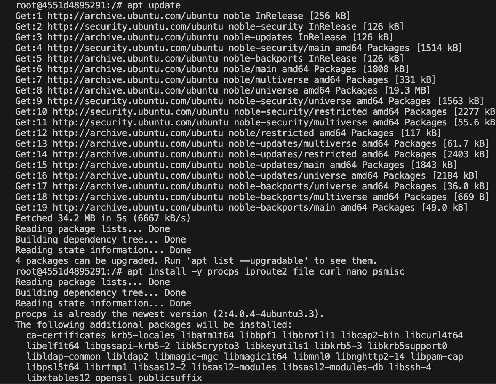

| 관측주체 | 확인할 수 있는 정보 |
| 로그 기록	| 프로그램이 무엇을 수행했는지 확인 |
| ps | 프로세스가 존재 유무 확인 |
| top | CPU,메모리 사용량 확인 |
| ps -l	| 내부 스레드 상태 확인 |
| ss | 네트워크 포트 사용 여부 확인 |

- 사용자 생성 명령어 : useradd -m -s /bin/bash agent-admin
- useradd	새로운 사용자 생성
- -m	사용자의 홈 디렉터리 생성
- -s	사용할 셸 지정
- /bin/bash	Bash 셸 사용
- agent-admin	생성할 사용자 이름
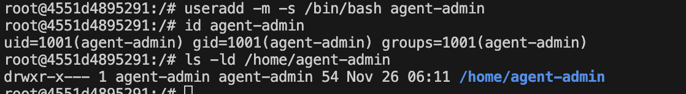

6) 실행용 디렉토리 생성
- /home/agent-admin/agent-app (프로그램 기본 실행 장소)
-  /home/agent-admin/agent-app/upload_files (업로드 파일 저장용)
- /home/agent-admin/agent-app/api_keys (인증키 저장용)
-  /var/log/agent-app (로그 기록용)
-  /home/agent-admin/results (장애 분석 결과 저장용)
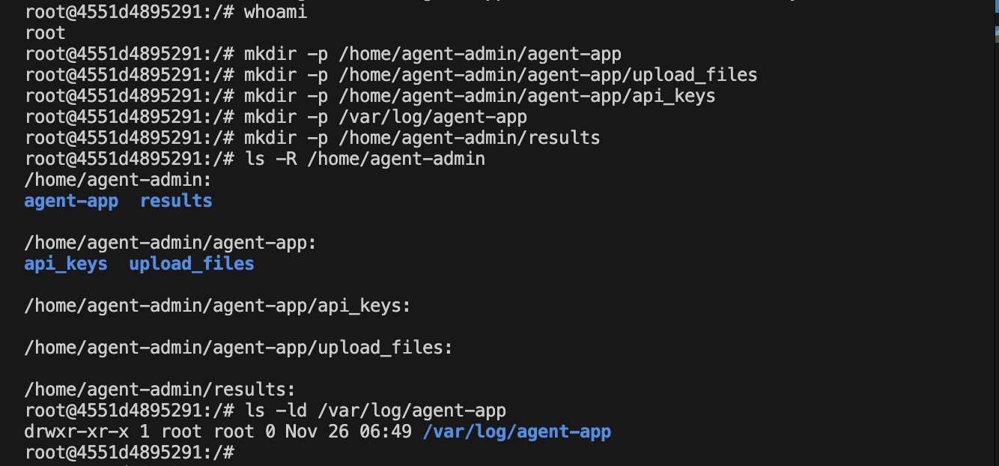

7) 바이너리 파일 복사
- 명령어 : cp /workspace/bin/agent-leak-app-x86 /home/agent-admin/agent-app/agent-leak-app
- 본 바이너리와 우분투에 있는 바이너리 파일 구분을 위해서 복사하면서 실습용 디렉토리와 동일한 이름으로 파일명 변경. 
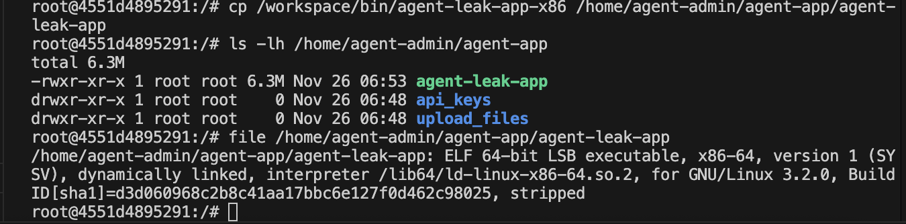

8) secret.key 생성
- 실습을 위한 테스트용 키 생성
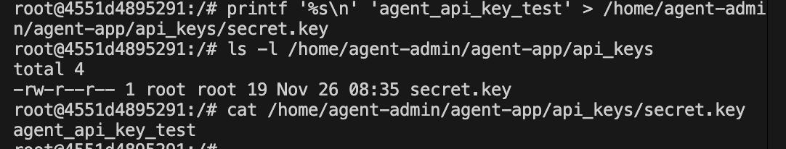

| 구분 | 설정값 |
| 키 파일 이름 | secret.key |
| 실제 키 값 | agent_api_key_test |
| 저장 디렉터리	| /home/agent-admin/agent-app/api_keys |
| 환경변수 | AGENT_KEY_PATH |
| 용도 | 프로그램의 필수 실행 조건 충족 |
| 종류 | 테스트용 인증 키 |

9) 소유자 및 권한 설정
- 소유자 변경 명령어 설명 :
- chown : change owner 
- -R : 하위 디렉토리까지 적용
- 1번째 agent-admin : 변경할 소유자
- : -> 소유자와 소유그룹 구분
- 2번째 agent-admin : 변경할 소유 그룹
- /home/agent-admin... : 변경대상 경로
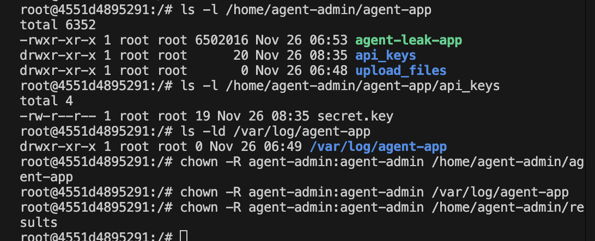

- 접근 권한 설정
- r(읽기/4), w(쓰기/2), x(실행/1), -(권한없음/0)
- 1번째 숫자(소유자) / 2번째 숫자(소유 그룹) / 마지막 숫자(기타사용자)
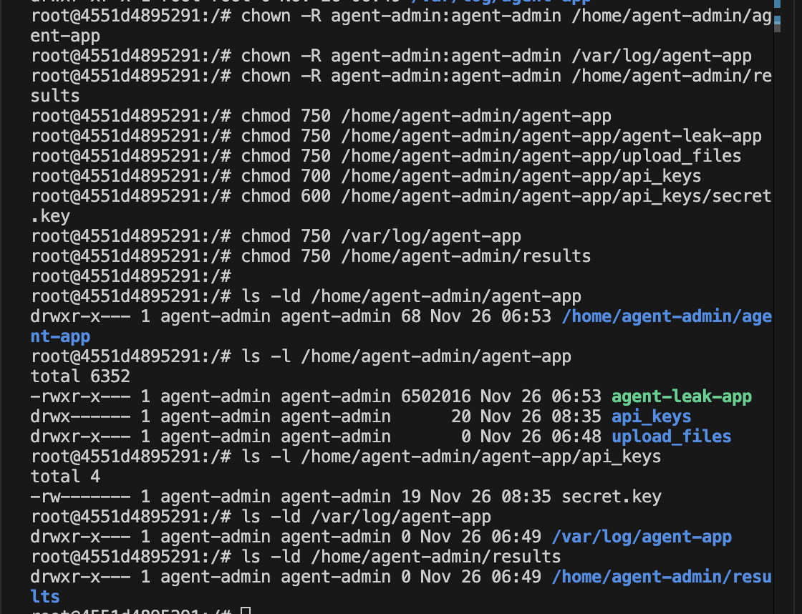

10) 일반 사용자로 전환
- 명령어 : su - agent-admin
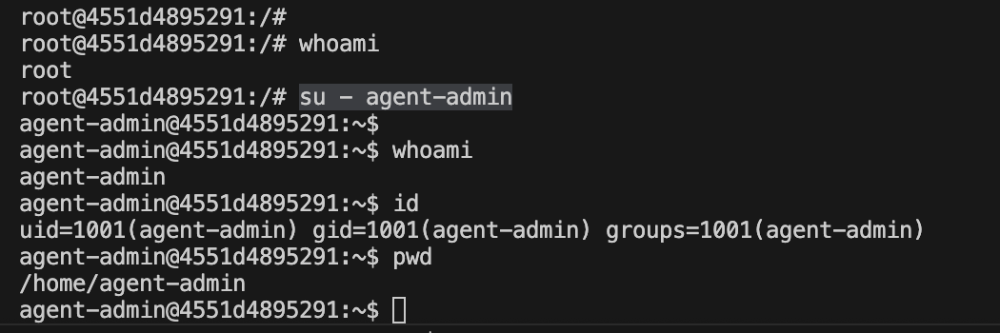

- 참고로 환경변수는 사용자 전환 후 지정한다. root 계정에서 환경변수 지정 후 사용자를 전환하면 새로운 로그인 환경을 구성하게 되므로 기존의 로그인 환경과 달라져서 내부적으로 환경변수를 초기화하게 된다. 따라서 환경변수는 사용자 전환 후 지정하는것이 좋다.
11) 필수 환경변수 설정
-
- 환경변수 설정 확인 명령어 설명 : 
- env : 현재 환경 변수 출력 
- \| : 앞 명령어의 출력 결과를 다음 명령어로 전달
- grep : 특정 문자열 검색
- ^ : 문자열 시작 위치
- -E : 정규표현식
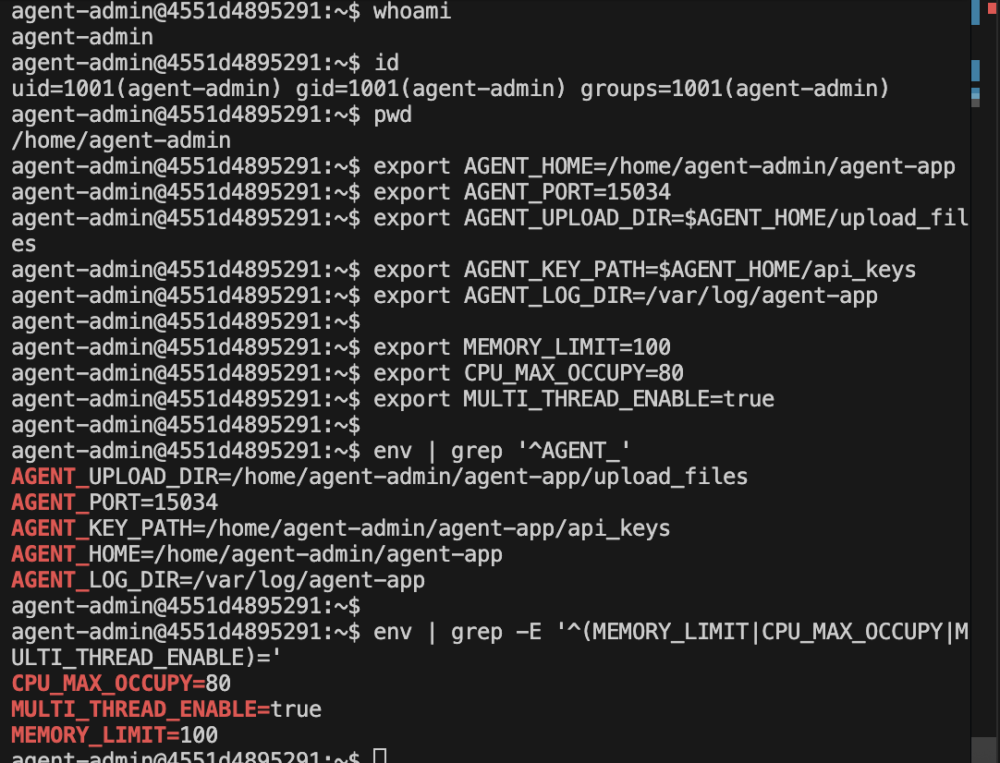

12) 실행 전 필수 조건 확인
- 이제까지 설정한 조건들이 제대로 되었는지 확인
- 환경변수로 디렉토리에 접근해서 권한 확인, test/-w 등의 명령어를 사용해서 권한 확인
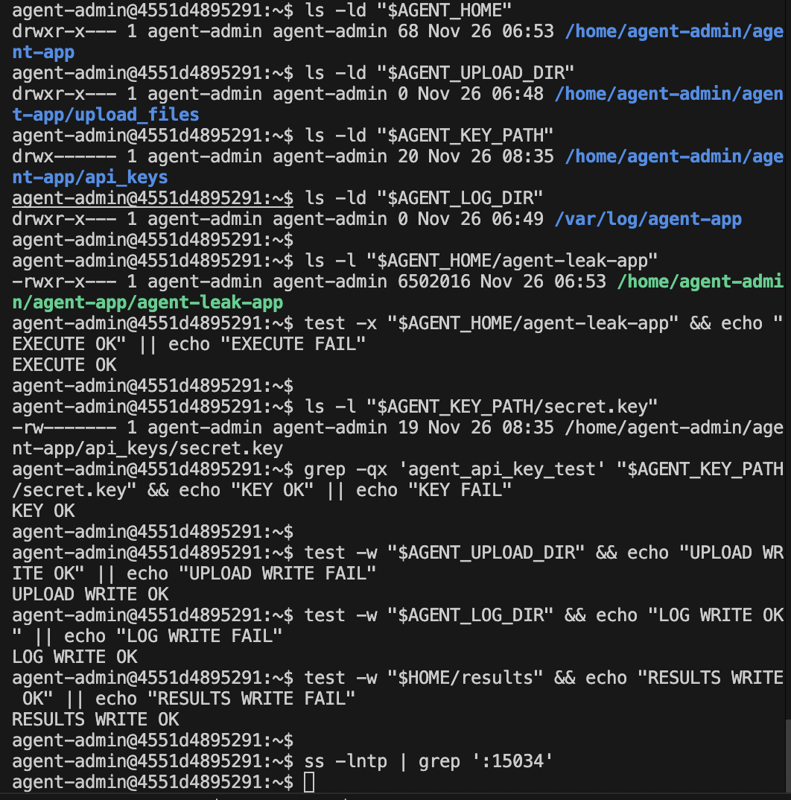

### 2. 시스템 장애 재현 (프로그램 실행)
1) 프로그램 실행 위치로 이동 & 분석용 설정값 확인
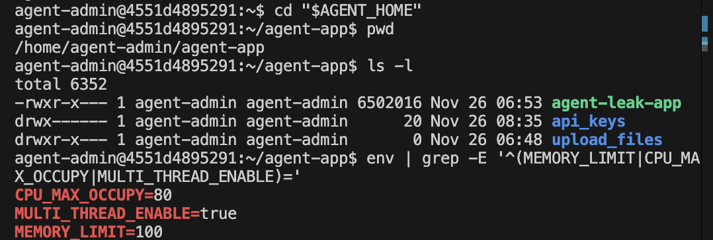

2) 프로그램 실행 & 로그 저장
- 실행 시 일반 출력과 오류 출력을 함께 할 수 있는 명령어 실행
- 명령어 : ./agent-leak-app 2>&1 | tee "$HOME/results/boot-test.log"
- ./agent-leak-app : 해당 디렉토리에 있는 프로그램 실행
- 2>&1 : 오류와 일반 모두 출력
- 출력 내용을 다음 명령어로 전달
- \| : tee : 화면 출력+파일 저장 동시 진행
- $HOME/results/boot-test.log : 실행 결과 저장할 경로
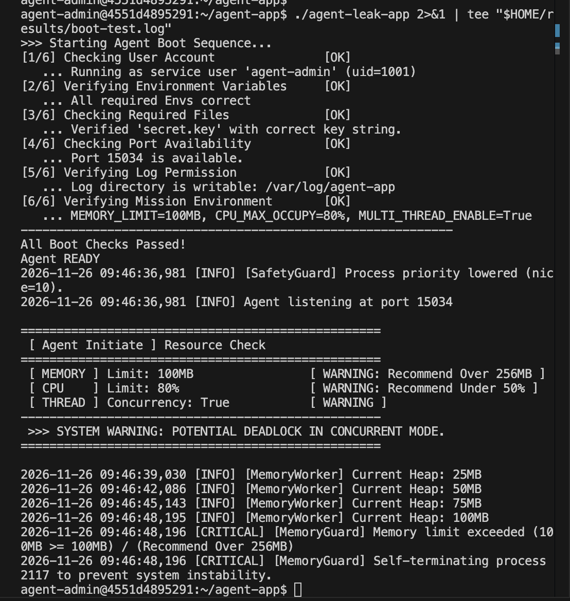

3) 새 터미널에서 모니터링 & 장애 발생
- 새 터미널에서 같은 컨테이너에 진입. pid(program id) 확인 -> app 이 실행중일 경우 해당 앱의 고유번호인 125 가 조회되어야 함 -> limit로 인해 프로세스 멈춤 -> 장애 발생으로 인해 모니터링 실패
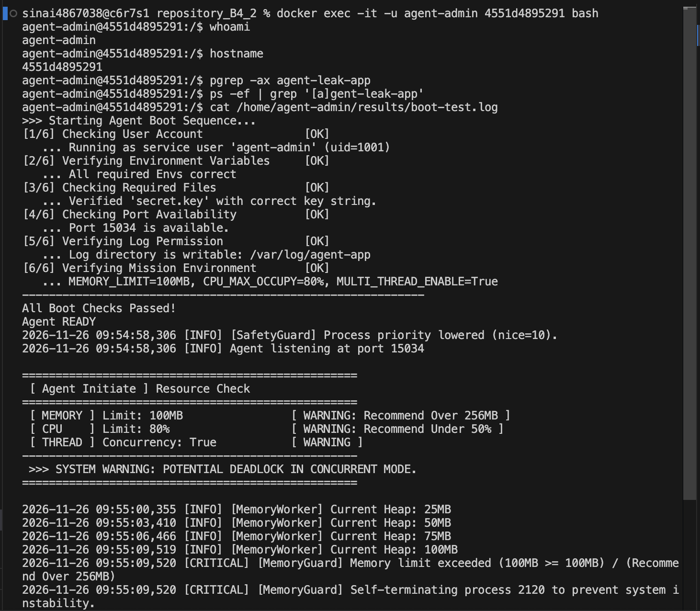 

- 원래 정상적으로 수행되었다면 아래 명령어를 통해 cpu 사용률, 시스템 메모리 대비 사용율 등을 확인할 수 있으나 실패함
- 명령어 : ps -p 125 -o pid,user,stat,pcpu,pmem,rss,vsz,nlwp,etime,comm

- ps -ef | grep '[a]gent-leak-app' => 명령어를 통해 앱이 실행되었는지 확인해보려고 했으나 아무것도 출력되지 않음.
- 로그 파일에 접근해서 기록 확인 : cat /home/agent-admin/results/boot-test.log
->momeryGaurd가 실제 작동해서 oom 장애 실제로 발생 확인 
- 최초 장애 발생 로그를 백업함 : cp /home/agent-admin/results/boot-test.log \
   /home/agent-admin/results/first-memory-crash.log
- 기존 프로세스 종료 여부 확인 : ps -p 2120 -o pid,user,stat,comm
  (종료되었다면 제목만 출력됨)
- 포트 상태 확인 : ss -lntp | grep ':15034'
  (프로그램 종료로 인해 포트가 해제되었다면 출력값 없음)

### 3. 모니터링 환경 구축
1) 실험 결과 저장 디렉토리 생성
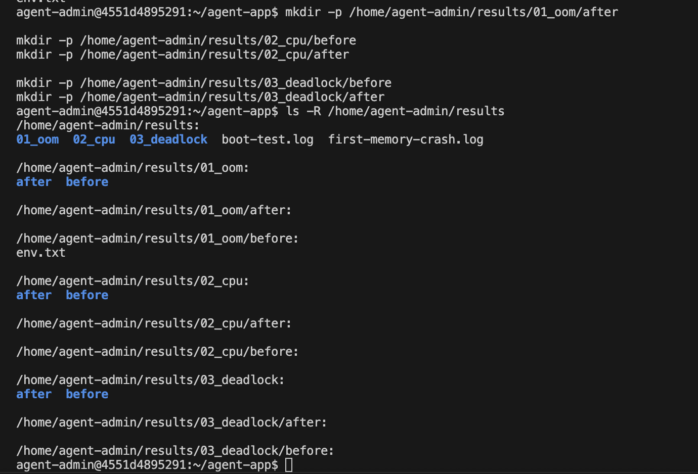
2) monitor.sh 파일 생성
- nano 편집기 열고 monitor.sh 파일 생성
```bash
nano /home/agent-admin/monitor.sh
````
```bash
#!/bin/bash

# 프로그램 이름 지정
APP_NAME="agent-leak-app"

echo "Waiting for $APP_NAME..."

# 프로그램이 실행될 때까지 대기
while true
do
    PID=$(pgrep -n -x "$APP_NAME")

    if [ -n "$PID" ]; then
        break
    fi

    sleep 0.2
done

echo "Monitoring started"
echo "Target PID: $PID"

# 프로그램이 실행 중인 동안 반복 측정
while ps -p "$PID" > /dev/null
do
    echo "----------------------------------------"

    date '+%Y-%m-%d %H:%M:%S'

    ps -p "$PID" -o pid,stat,pcpu,pmem,rss,vsz,nlwp,etime,comm

    sleep 1
done

echo "----------------------------------------"

date '+%Y-%m-%d %H:%M:%S'

echo "Target process $PID has terminated."
echo "Monitoring finished."
```
- monitor.sh 파일 생성 확인 : ls -l /home/agent-admin/monitor.sh
- monitor.sh 파일 권한 설정 : chmod 750 /home/agent-admin/monitor.sh
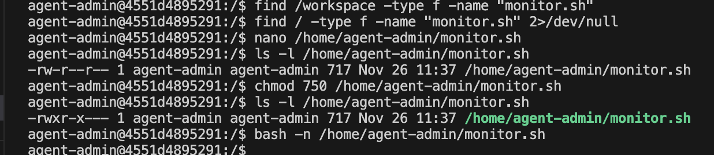

2) 3번째 터미널 생성
- 1st 터미널 : 프로그램 실행용 (./agent-leak-app) : 실행, 로그 저장
- 2nd 터미널 : 모니터링용 (monitor.sh) : cpu, 메모리 사용량 측정 및 저장
- 3rd 터미널 : 추가 관측용 (ps, top, ss) : 프로세스, 스레드, 포트 확인 및 증거 캡쳐

- 3번째 터미널 생성 후 monitor.sh 파일이 돌아가는지 확인 & 2번째 터미널에서 monitor.sh 파일을 실행한다 -> 그럼 3번째 터미널에서 관측한 결과가 보여진다.
(첫번째 이미지가 3번째 터미널, 두번째 이미지가 2번째 터미널)
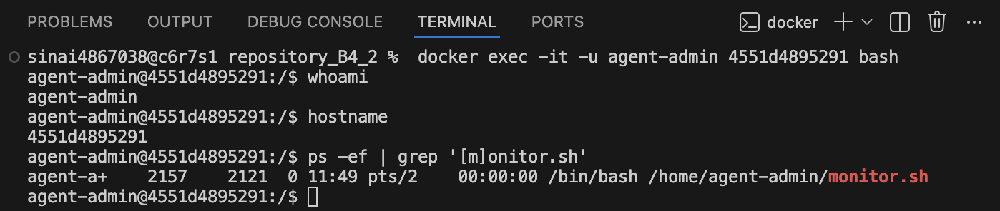
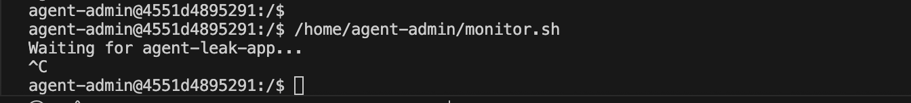


