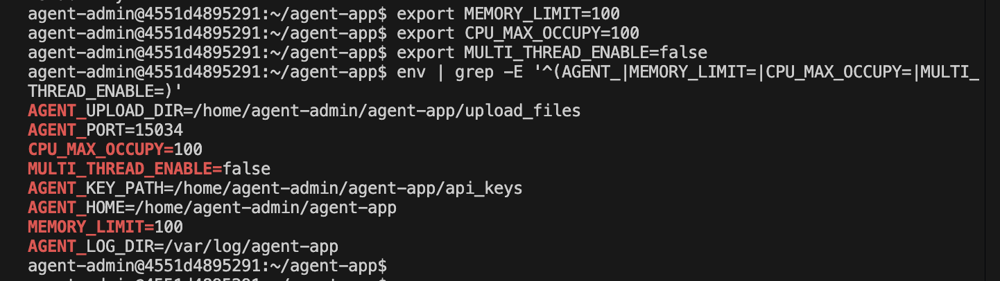
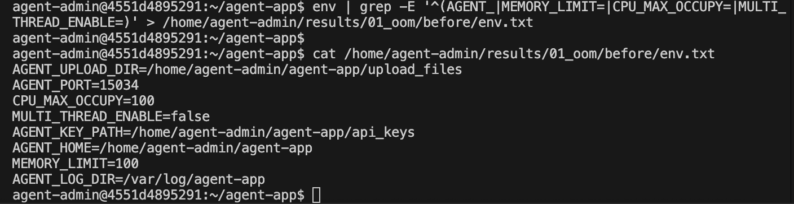

## 1. OOM Crash - Before test
- 메모리 누수 현상 (조치 전 테스트)
- 로그램의 메모리 사용량이 증가하면서 설정된 임계치에 도달하고, MemoryGuard에 의해 프로그램이 종료되는 현상을 재현한다.

| 환경변수 | 기존 설정값 | 이번 실험 설정값 | 설정 이유 |
| MEMORY_LIMIT | 100 | 100 | 메모리 장애 재현 |
| CPU_MAX_OCCUPY | 80 | 100 | CPU 보호 정책에 의한 종료 가능성 감소 |
| MULTI_THREAD_ENABLE | true | false | 멀티스레드 작업에 의한 Deadlock 가능성 감소 |

- 테스트 순서
1st 터미널 : 환경변수 설정 & 실험 조건 저장
       &larr;
2nd 터미널 : monitor.sh 실행 & PID 검색 대기 
       &larr;
3rd 터미널 : top 자동 관측 준비
       &larr;
1st 터미널 : agent-leak-app 실행
       &larr;
3rd 터미널 : 장애 발생 및 측정 결과 확인

1) 환경변수 설정 & 실험 조건 저장

