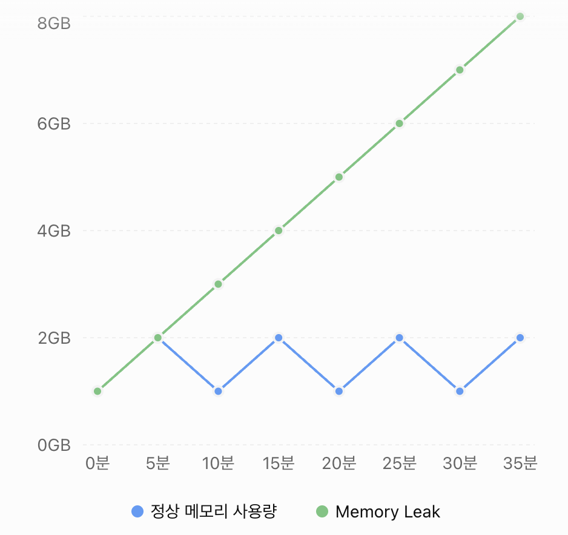
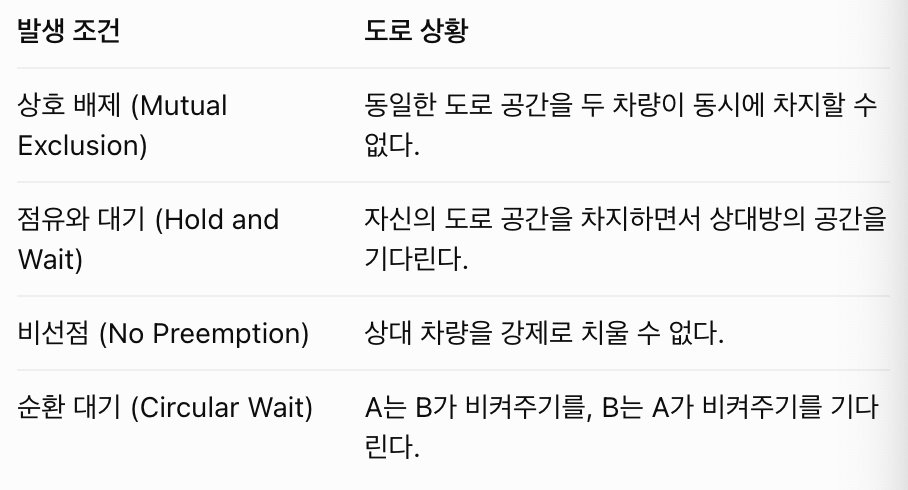
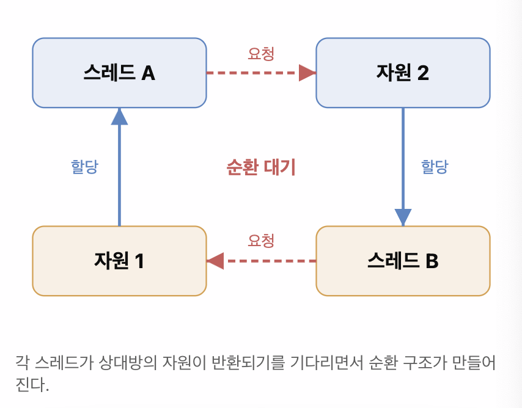
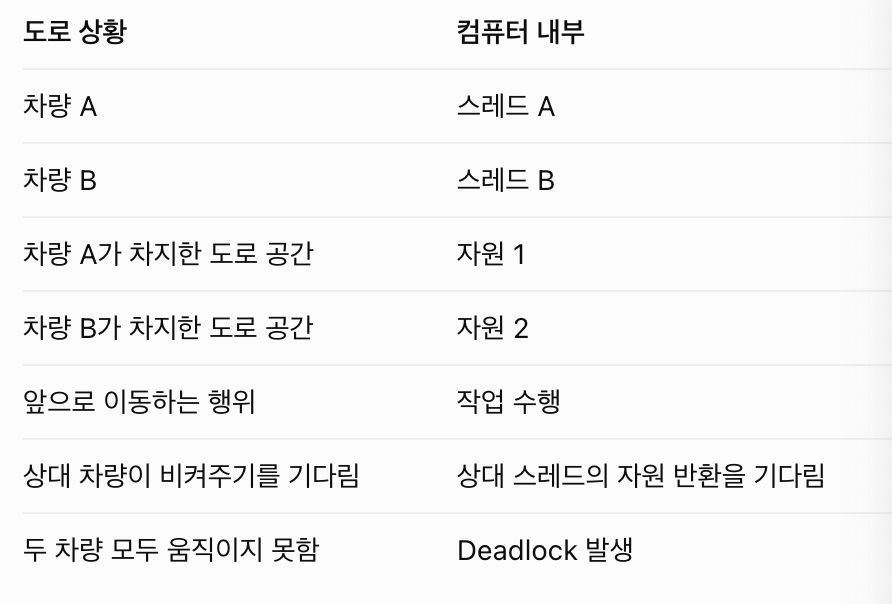
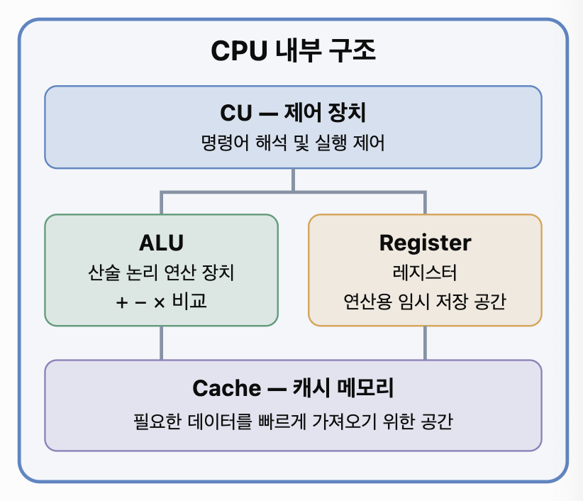

## 1. 시스템 장애 종류 3가지
### 1) 기본 용어
- CPU : 중앙처리장치. 계산, 판단, 명령 수행등의 역할
- RAM : 컴퓨터가 작업하는 동안 필요한 데이터를 임시로 올려놓는 공간 
- 자원 : 프로그램 작업시 필요한 것. CPU, RAM도 자원의 일종
### 2) memory leak : '메모리 누수'
- 프로그램이 메모리 사용 후 더이상 사용할 필요가 없음에도 불구하고 반환하지 않아서 사용할 메모리가 점점 줄어드는 현상
- 메모리 상태가 정상적인 경우 파랑색 처럼 사용 후 반환해서 그래프가 우하향 하는 것이 보여져야 한다. 하지만 반환하지 않아서 메모리 사용량이 계속 증가하는 패턴 (녹색 그래프))을 보이게 되면 메모리 누수 상태라고 판단한다.

### 3) CPU spike : 'CPU 과부하(사용량 급증)'
- CPU가 처리해야 할 작업이 갑자기 많아져서 CPU 사용량이 급격하게 증가하는 현상
- 예시) 요리사가 2명 뿐인 식당에 갑자기 점심 손님 500명 찾아와서 점심 식사 주문하는 상황
- CPU 사용량 증가시 마우스나 키보드 반응 느려질 가능성 높고, 발열도 증가함

### 4) Deadlock : '교착상태'
- 두 개 이상의 작업이 서로 상대방이 가지고 있는 자원을 기다리면서 그 어느 쪽도 작업을 진행하지 못하고 멈춘 상태
- 예시) 1대의 차량만 지나갈 수 있는 좁은 골목에서 차 2대가 서로 마주한 상황. 한 차량이 후진해서 골목을 나오지 않는 이상 그 어느 차량도 움직일 수 없음
- deadlock 발생 조건 : 상호배제, 점유와 대기, 비선점, 순환 대기

- '스레드' 라는 개념 : 여러 작업을 동시에 처리하기 위해 스레드(thread)라는 작업 실행 단위를 사용한다

## 2. 시스템 장애가 발생하는 이유
1) 특정 프로세스의 CPU 과점유가 시스템 지연을 유발할 경우
- 원인 : 다른 프로세스가 CPU를 사용할 기회를 충분히 얻지 못하기 때문
  => 즉, CPU가 작업을 처리하는 속도보다 새로운 작업이 들어오는 속도가 빠르면 대기열이 길어지고, 그만큼 작업이 기다려야 하는 시간이 증가함. 
  => 응답시간 = 대기시간+실제 처리 시간+기타 처리 지연 시간으로 볼 수 있고, 이 중 하나라도 늦어지면 응답시간이 길어지면서 컴퓨터가 느리다고 느끼게 됨. 
- 프로세스 개념 : 실행중인 프로그램
- 스케줄러 : 어떤 작업에 CPU 사용 기회를 줄지 결정하는 기능 (커널이라고 보면 됨)
- CPU는 여러개의 작업을 매우 빠른 속도로 작업 전환함 (A작업 수행-> 작업 전환 -> B작업 수행  -> 작업전환 -> C작업 진행...)) =>문맥 교환(context switching) 이라고 함.
- 

## 3. 시스템 장애 발생시 고려해볼만한 해결 방법
1) memory leak

2) CPU spiike
- 멀티 코어 사용 : CPU=주방/코어=요리사 라고 가정한다면 연산을 수행하는 코어를 늘려서 작업의 병렬처리를 가능하게 만든다
- GPU 활용 (오프로딩) : 일부 연산을 GPU에게 맡겨서 부담 줄이기
- queue(큐) 사용 : 작업을 대기열에 넣고 감당할 수 있는 만큼 꺼내서 작업처리 => 이 경우 시스템이 과부하로 멈추는걸 예방할 수 있겠으나 사용자의 대기 시간이 길어질 수 있다는 단점도 존재함
- 기존 컴퓨터의 하드웨어 업그레이드 (식당의 경우 식당 크기 늘리기)
- sacale out : load Balancer와 서버를 추가로 설치하여 로드 밸런서가 작업을 분산하면 각 서버가 분산된 작업을 각각 처리하는 것 (식당의 경우 지점 추가)
- cache(캐시) : 동일한 연산 반복보다 이전에 계산한 결과를 저장했다가 다음에 다시 사용하기 => 저장해두변 db에서 조회하는 단계를 줄임으로 CPU 처리 작업을 줄일 수 있음

3) deadlock
